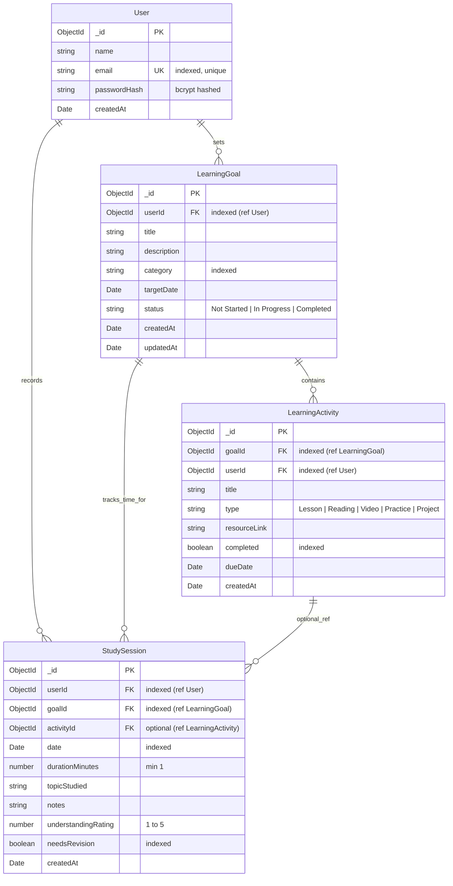

# Learning Progress Tracker — MERN Stack

> **A Web-Based MERN Application for Planning Learning Activities, Recording Study Sessions, Monitoring Progress, and Evaluating Consistency Over Time**

**Learning Progress Tracker** helps students plan their learning activities, record granular study sessions, track progress toward topic goals, self-assess understanding, and visualize learning consistency over time.

---

## 🌟 Core Features

1. **Learning Goals**
   - Plan broad subjects and milestones (e.g., *C Programming*, *DBMS*, *Machine Learning*).
   - Set target dates, categories, and track statuses: `Not Started`, `In Progress`, and `Completed`.
   - Track total study hours invested into each goal.

2. **Learning Activities & Resources**
   - Break goals down into granular activities: `Lesson`, `Reading`, `Video`, `Practice`, `Project`, and `Quiz`.
   - Attach external learning resources, documentation links, and textbook chapters.
   - Mark activities as complete with automatic goal progress recalculation:
     $$\text{Progress} = \left(\frac{\text{Completed Activities}}{\text{Total Activities}}\right) \times 100$$

3. **Study Session Tracking**
   - Log study duration in minutes or quick presets (25m Pomodoro, 45m, 60m, 90m, 120m).
   - Record study dates, specific topics studied, and personal notes.
   - Link study sessions to specific learning goals or record independent study.

4. **Self-Assessment & Revision System**
   - Rate your grasp of the topic on a 1-to-5 star scale:
     - 1 Star: *Confused / Needs major help*
     - 2 Stars: *Weak understanding / Flagged for revision*
     - 3 Stars: *Moderate grasp / Some doubts*
     - 4 Stars: *Good understanding / Confident*
     - 5 Stars: *Mastered / Fully grasped*
   - Topics rated $\le 2$ stars are automatically queued into the **Self-Assessment & Revision Center** to facilitate active recall and spaced repetition.

5. **Progress & Consistency Dashboard**
   - KPI metrics: Total Study Hours, Completed Goals, Understanding Index, Revision Count.
   - **Weekly Consistency Chart**: 7-Day bar graph tracking daily minutes and session frequency over the past week.
   - Topics needing revision callouts with instant "Log Revision Session" shortcuts.

6. **Student Authentication & Data Privacy**
   - Secure student registration and login with **JSON Web Tokens (JWT)**.
   - Password hashing with **bcryptjs** (salt rounds = 10).
   - Strict data privacy: every goal, activity, and session is tied to the student's unique `userId`.

---

## 🛠️ Technology Stack

| Layer | Technology | Role |
| :--- | :--- | :--- |
| **Database** | MongoDB | Stores `users`, `learningGoals`, `learningActivities`, and `studySessions` with document references and indexes. |
| **Backend** | Express.js & Node.js | REST APIs, JWT authentication middleware, schema validation, aggregation pipelines. |
| **Frontend** | React 18 & Vite | Fast Single Page Application (SPA) styled with Tailwind CSS and Lucide Icons. |
| **API Testing** | Postman | Preconfigured collection with automatic JWT token extraction and environment variables. |

---

## 🗄️ MongoDB Database Design & DBMS Evaluation

### Collections & Entity Relationships

The schema design follows a normalized document reference pattern:
- **One User (`User`)** $\rightarrow$ **Multiple Goals (`LearningGoal`)**
- **One Goal (`LearningGoal`)** $\rightarrow$ **Multiple Activities (`LearningActivity`)**
- **One User (`User`)** $\rightarrow$ **Multiple Sessions (`StudySession`)**, optionally linked to a `LearningGoal` or `LearningActivity`.



### High-Performance MongoDB Aggregations

#### 1. 7-Day Weekly Consistency Pipeline
```javascript
StudySession.aggregate([
  {
    $match: {
      userId,
      date: { $gte: sevenDaysAgo }
    }
  },
  {
    $group: {
      _id: { $dateToString: { format: "%Y-%m-%d", date: "$date" } },
      minutes: { $sum: "$durationMinutes" },
      sessionCount: { $sum: 1 }
    }
  },
  { $sort: { _id: 1 } }
]);
```

#### 2. Goal Progress & Study Hours Pipeline
```javascript
LearningGoal.aggregate([
  { $match: { userId } },
  {
    $lookup: {
      from: 'learningactivities',
      localField: '_id',
      foreignField: 'goalId',
      as: 'activities'
    }
  },
  {
    $lookup: {
      from: 'studysessions',
      localField: '_id',
      foreignField: 'goalId',
      as: 'sessions'
    }
  },
  {
    $project: {
      title: 1,
      category: 1,
      status: 1,
      totalActivities: { $size: '$activities' },
      completedActivities: {
        $size: {
          $filter: {
            input: '$activities',
            as: 'a',
            cond: { $eq: ['$$a.completed', true] }
          }
        }
      },
      totalStudyHours: {
        $round: [{ $divide: [{ $ifNull: [{ $sum: '$sessions.durationMinutes' }, 0] }, 60] }, 1]
      },
      progress: {
        $cond: [
          { $gt: [{ $size: '$activities' }, 0] },
          {
            $round: [
              {
                $multiply: [
                  {
                    $divide: [
                      { $size: { $filter: { input: '$activities', as: 'a', cond: { $eq: ['$$a.completed', true] } } } },
                      { $size: '$activities' }
                    ]
                  },
                  100
                ]
              },
              0
            ]
          },
          0
        ]
      }
    }
  }
]);
```

---

## 📁 Directory Structure

```
Learning Progress Tracker/
├── client/                     # React Frontend (Vite + Tailwind CSS)
│   ├── src/
│   │   ├── api/client.js       # Axios HTTP client with JWT interceptor
│   │   ├── context/            # AuthContext (login, register, logout)
│   │   ├── components/         # Navbar, ProgressBar, StatsCard, GoalModal, ActivityModal, SessionModal
│   │   ├── pages/              # Dashboard, GoalsPage, GoalDetailsPage, SessionsPage, RevisionPage, ReportsPage
│   │   ├── App.jsx             # Progress Tracker navigation router
│   │   └── main.jsx            # React root mount
│   ├── index.html
│   └── vite.config.js
├── server/                     # Express & Node.js Backend API
│   ├── config/db.js            # Mongoose MongoDB connection
│   ├── controllers/            # authController, goalController, activityController, sessionController, analyticsController
│   ├── middleware/             # JWT auth protection & error handler
│   ├── models/                 # User.js, LearningGoal.js, LearningActivity.js, StudySession.js
│   ├── routes/                 # authRoutes, goalRoutes, activityRoutes, sessionRoutes, analyticsRoutes
│   ├── test_e2e_progress.js    # Automated E2E verification test suite
│   ├── .env                    # Environment configuration
│   └── server.js               # Express application entry point
├── postman/
│   └── Learning_Progress_Tracker.postman_collection.json # Ready-to-import Postman collection
├── package.json
└── README.md
```

---

## 🚀 Getting Started

### 1. Prerequisites
- **Node.js** (v18 or higher)
- **MongoDB** (Local instance on `mongodb://127.0.0.1:27017` or MongoDB Atlas URI)

### 2. Backend Setup
```bash
cd server
npm install
npm start
# Backend API runs on: http://localhost:5000
```

### 3. Frontend Setup
In a new terminal:
```bash
cd client
npm install
npm run dev
# Frontend runs on: http://localhost:5173
```

Open `http://localhost:5173` in your browser.

---

## 🧪 Automated Testing

Run the automated verification suite to test goal creation, activity tracking, study session logging, 150m study hour sum, weekly consistency grouping, and revision auto-flagging:
```bash
cd server
node test_e2e_progress.js
```

---

## 📬 Postman API Collection

Import `postman/Learning_Progress_Tracker.postman_collection.json` into Postman to test:
- **Authentication**: Register, Login, Get Profile.
- **Learning Goals**: CRUD operations with progress and total study hours.
- **Learning Activities**: Add lesson/practice activities, toggle completion.
- **Study Sessions**: Record sessions with durations, notes, understanding ratings (1–5), and revision toggles.
- **Analytics**: Retrieve 7-day consistency and revision queue via `/api/analytics/dashboard`.
